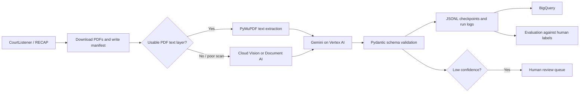

# Court Document Extraction Pipeline

## Project Summary

Court Document Extraction is a batch-processing pipeline that converts public court-filing PDFs into structured, validated legal records. It downloads public documents from CourtListener/RECAP, obtains text directly from the PDF or through OCR, uses Gemini on Vertex AI to extract legal fields, validates the response, and stores results and operational logs in BigQuery.

The project is designed as a production-shaped workflow rather than a simple AI demo. It includes schema validation, resumable processing, retry handling, OCR caching, confidence-based human review, and an evaluation framework based on human-authored ground truth.

## End-To-End Workflow



## Processing Stages

### 1. Acquire Public Court Documents

The pipeline calls the CourtListener/RECAP API with an API token. It saves PDFs locally and records source metadata in a JSONL manifest. The manifest contains the document ID, CourtListener metadata, description, and local file path.

The acquisition process is resumable. Documents already present in the manifest are skipped on later runs. It also handles temporary rate limits with exponential backoff.

### 2. Inventory and Route PDFs

Each PDF is inspected to determine whether it contains a meaningful embedded text layer. This matters because direct text extraction is cheaper, faster, and generally more accurate than OCR.

The OCR router supports three paths:

- **Embedded text:** PyMuPDF extracts text already contained in the PDF.
- **Cloud Vision:** Used for clean image-only scans.
- **Document AI:** Used for lower-resolution, blurry, skewed, or structurally complex scans.

The routing decision uses substantive text length, effective image resolution, Laplacian blur variance, and skew angle. OCR results are cached so paid OCR is never repeated for the same document.

### 3. Extract Legal Fields with Gemini

Gemini 2.5 Flash runs through Vertex AI with JSON output constrained by a typed schema. It extracts fields such as:

- Case name and docket number
- Court name and filing date
- Document type: complaint, motion, order, brief, or notice
- Parties and their roles
- Attorneys, firms, and represented parties
- Judge name and filing party
- Relief sought and redaction status
- Per-field and overall confidence
- Notes explaining ambiguity

The model uses `temperature=0.0`, because extraction should be repeatable and based on evidence in the document rather than creative variation.

### 4. Validate and Persist Results

Pydantic validates every model response after Gemini returns it. This protects the database from malformed JSON, unsupported document categories, and unexpected data shapes.

Each completed document is appended immediately to local JSONL checkpoint files. If a long batch stops midway, a rerun processes only unfinished documents.

The pipeline logs input tokens, output tokens, latency, OCR path, retry count, status, and an optional estimated cost. Cost remains unset until current official Vertex AI rates are configured locally; no pricing is invented by the application.

### 5. Route Uncertain Records to Human Review

A record enters the review queue when either its overall confidence or an individual field confidence is `LOW`. The review CLI displays the source OCR text alongside the extracted record, then lets a reviewer accept, edit, or skip it. Accepted or corrected records receive a reviewer identifier and timestamp.

### 6. Store Results in BigQuery

The BigQuery dataset contains three tables:

- `extractions`: one structured record per document
- `run_logs`: operational metrics per processed document
- `review_queue`: records that require human review

Parties and attorneys are stored as repeated nested records (`ARRAY<STRUCT>`). This keeps one row per court document while retaining one-to-many legal entities.

### 7. Evaluate Against Ground Truth

The project includes a workflow for human-authored labels. A helper prepares each document's OCR text and blank JSON label. The evaluator compares predictions with manually created ground truth and calculates field-level precision, recall, F1, and confidence calibration.

Prompt versions can be compared fairly by keeping the documents, OCR cache, model, and temperature the same while changing only the prompt.

## Technology Stack

| Technology | Purpose |
|---|---|
| Python 3.12 | Primary implementation language |
| Google Cloud Platform | Cloud platform |
| Vertex AI and Gemini 2.5 Flash | Structured information extraction |
| `google-genai` | Gemini Vertex AI SDK |
| Pydantic | Typed response validation |
| CourtListener / RECAP API | Public court-document source |
| PyMuPDF | PDF inspection and embedded-text extraction |
| Cloud Vision API | OCR for clear image-only scans |
| Document AI | OCR for lower-quality or complex scans |
| OpenCV | Blur and skew estimation for OCR routing |
| BigQuery | Structured extraction, run-log, and review storage |
| Cloud Storage | Document storage for deployed batch runs |
| Cloud Run Jobs | Batch-job deployment target |
| Docker | Container packaging |
| GitHub Actions | CI/CD workflow template |
| Workload Identity Federation | GitHub-to-GCP authentication without service-account key files |
| Pytest | Automated unit testing |
| JSONL | Append-friendly local checkpoints and labels |

## Real Results So Far

The initial live run processed five public CourtListener PDFs.

| Measure | Result |
|---|---:|
| Downloaded documents | 5 |
| PDFs with embedded text | 5 |
| Successful Gemini extractions | 5 |
| BigQuery extraction records | 5 |
| BigQuery run logs | 5 |
| Human-review queue items | 4 |
| Input tokens | 11,169 |
| Output tokens | 2,063 |
| Mean extraction latency | 18.775 seconds |
| Automated tests passing | 10 |

All five initial PDFs had usable embedded text, so the free PyMuPDF path was used. The paid Cloud Vision and Document AI OCR paths have been implemented but have not yet been compared using a real image-only scan corpus.

## Current Commands

```powershell
# Verify all GCP services and credentials
.\.venv\Scripts\python.exe verify_setup.py

# Acquire a small, safe batch of documents
.\.venv\Scripts\python.exe -m src.acquire acquire --limit 5

# Inspect local PDF inventory
.\.venv\Scripts\python.exe -m src.acquire inventory

# Extract structured records from pending documents
.\.venv\Scripts\python.exe -m src.pipeline --limit 5

# Create or update BigQuery tables, then load checkpoints
.\.venv\Scripts\python.exe -m src.bq init
.\.venv\Scripts\python.exe -m src.bq load

# Review low-confidence records
.\.venv\Scripts\python.exe -m src.review --reviewer your-name

# Prepare and collect a human label
.\.venv\Scripts\python.exe -m eval.label prepare DOCUMENT_ID
.\.venv\Scripts\python.exe -m eval.label collect DOCUMENT_ID

# Run automated tests
.\.venv\Scripts\python.exe -m pytest -q
```

## Remaining Work Before Final Portfolio Metrics

The implementation is complete for the main workflow, but the following real-data steps are still required before reporting final accuracy or deployment claims:

1. Collect an image-only scan sample and compare Cloud Vision with Document AI for accuracy, latency, and cost.
2. Hand-label approximately 40 to 50 documents in the ground-truth dataset.
3. Run prompt versions `v1` and `v2` over the same evaluation documents.
4. Publish real per-field precision, recall, F1, and confidence-calibration results.
5. Configure GitHub Workload Identity Federation, Artifact Registry, and Cloud Run Job deployment.

No unmeasured accuracy, cost, calibration, or OCR-comparison figures should be claimed until these runs are completed.