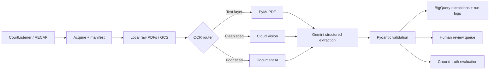

# Court Document Extraction

A batch pipeline for turning scanned public court filings into validated structured records. It uses OCR and Gemini on Vertex AI, records confidence per field, and routes uncertain extractions to a human-review queue.

## Status

The implementation is in place and has passed configuration, schema, routing, and evaluation-support tests. Three PDFs were acquired in the initial rate-limited sample; do not claim accuracy, calibration, OCR comparison, cost, or latency results until the required real runs and hand labeling are complete.

## Architecture



## Project Layout

- `config.py`: loads and validates all environment configuration.
- `src/acquire.py`: downloads CourtListener/RECAP documents and creates the manifest/inventory.
- `src/ocr.py`: chooses embedded text, Cloud Vision, or Document AI and caches results.
- `src/extract.py`: calls Gemini with typed schema-constrained output.
- `src/schema.py`: defines Pydantic validation for the extraction contract.
- `src/prompts/`: contains versioned prompt files for reproducible evaluation.
- `src/pipeline.py`: orchestrates concurrent retries, checkpoints, and per-document logs.
- `src/review.py`: creates the low-confidence human-review queue.
- `src/bq.py`: creates and loads BigQuery tables.
- `eval/`: holds hand-labeled ground truth and field-level evaluation/calibration.
- `data/`: holds local PDFs and OCR cache; it is intentionally excluded from Git.
- `tests/`: will hold automated tests as behavior is introduced.

## Local Setup

```powershell
.\.venv\Scripts\python.exe -m pip install -r requirements.txt
.\.venv\Scripts\python.exe verify_setup.py
.\.venv\Scripts\python.exe -m src.acquire acquire --limit 5
.\.venv\Scripts\python.exe -m src.acquire inventory
.\.venv\Scripts\python.exe -m src.pipeline --limit 5
.\.venv\Scripts\python.exe -m eval.label prepare 488912430
pytest
```

Copy `.env.example` to `.env` when setting up another machine. Keep `.env` private; it contains API credentials and is ignored by Git.

## Evaluation And Limits

Use `eval/evaluate.py` only with records you label by hand in `eval/ground_truth.jsonl`. The comparison must use the same documents, OCR cache, model, and temperature for both prompt versions. `parties` and `attorneys` are stored as BigQuery `ARRAY<STRUCT>` values: this preserves one row per document and supports nested queries; a flattened table would simplify party-level joins but duplicate document-level fields.

To label a document, run `python -m eval.label prepare DOCUMENT_ID`, read `data/labeling/DOCUMENT_ID.txt`, and complete the matching JSON file. Then run `python -m eval.label collect DOCUMENT_ID`. These labels must be authored by a person; model-produced labels would invalidate the evaluation.

The current router uses substantive embedded text first, Cloud Vision for clear image-only scans, and Document AI for low-resolution or blurry scans. Its thresholds are provisional until the required OCR comparison produces real agreement, cost, and latency data.