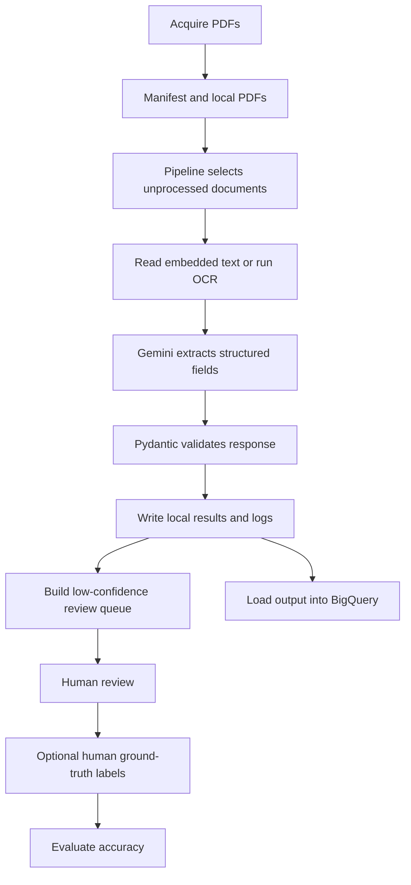

# Court Document Extraction Workflow Guide

## What The Project Does

This project converts public court-document PDFs into validated structured legal records. It downloads PDFs, obtains their text, asks Gemini to extract legal fields, validates the result, queues low-confidence records for human review, and can store outputs in BigQuery.



## 0. Configuration

File: `config.py`

The application reads credentials and settings from `.env`:

- Google Cloud project and location
- Gemini model
- BigQuery dataset
- Cloud Storage bucket
- Document AI processor
- CourtListener API token
- Number of workers and default document limit

Check that the local and cloud setup works:

```powershell
.\.venv\Scripts\python.exe verify_setup.py
```

## 1. Download Court PDFs

Command:

```powershell
.\.venv\Scripts\python.exe -m src.acquire acquire --limit 5
```

Entry point: `src/acquire.py`

What it does:

1. Calls the CourtListener / RECAP API.
2. Downloads public PDFs into `data/raw/`.
3. Records document metadata and each local PDF path in `data/raw/manifest.jsonl`.

Example downloaded file:

```text
data/raw/488912430.pdf
```

The manifest is the source inventory for the pipeline. The pipeline reads it to know which documents are available and where their PDFs are located.

To inspect the local PDF inventory:

```powershell
.\.venv\Scripts\python.exe -m src.acquire inventory
```

This reports whether documents have embedded text or are image-only scans.

## 2. Run The Extraction Pipeline

Command:

```powershell
.\.venv\Scripts\python.exe -m src.pipeline --limit 5
```

Entry point: `src/pipeline.py`

The pipeline reads:

- `data/raw/manifest.jsonl` for available documents
- `data/extractions.jsonl` for already-completed document IDs

It processes only document IDs that are in the manifest but not already in `extractions.jsonl`. This makes reruns resumable and avoids repeating completed extraction work.

If the output says this:

```text
Processing 0 documents with 5 workers
```

then every document in the manifest was already processed. No new OCR or Gemini request was made.

To process all pending documents:

```powershell
.\.venv\Scripts\python.exe -m src.pipeline
```

To use the second extraction prompt version:

```powershell
.\.venv\Scripts\python.exe -m src.pipeline --prompt-version v2
```

## 3. Obtain PDF Text Or OCR

File: `src/ocr.py`

For every new document, the pipeline calls `extract_text`. First it checks for a cached result here:

```text
data/ocr/DOCUMENT_ID.json
```

For example:

```text
data/ocr/488912430.json
```

Each cache file stores:

- Extracted text
- OCR route used
- PDF quality measurements

The router chooses one of these paths:

| PDF condition | Route | Action |
|---|---|---|
| At least 100 embedded text characters | `embedded_text` | Extract text directly using PyMuPDF |
| Image-only but clear | `vision` | Use Google Cloud Vision OCR |
| Low-resolution, blurry, or skewed image-only scan | `document_ai` | Use Google Document AI |

Caching prevents paid OCR from being repeated for the same document.

## 4. Gemini Structured Extraction

File: `src/extract.py`

The pipeline combines:

1. OCR or embedded PDF text from `data/ocr/DOCUMENT_ID.json`
2. A versioned instruction prompt from `src/prompts/v1.txt` or `src/prompts/v2.txt`

It sends this to Gemini through Vertex AI. Gemini is configured to return JSON at temperature `0.0` for consistent extraction.

The expected fields include:

- Case name and docket number
- Court and filing date
- Document type
- Parties and attorneys
- Judge name and filing party
- Relief sought and redaction status
- Per-field confidence and overall confidence
- Extraction notes

## 5. Validate The Response

File: `src/schema.py`

Gemini's JSON is validated using Pydantic before it is stored. Validation ensures, for example:

- Document type is one of `COMPLAINT`, `MOTION`, `ORDER`, `BRIEF`, or `NOTICE`.
- Party roles and party types use allowed values.
- Confidence values are `HIGH`, `MEDIUM`, or `LOW`.
- Parties and attorneys have the expected structure.

If a response is invalid, the pipeline writes an error result and log rather than storing malformed data.

## 6. Files Created By The Pipeline

`src/pipeline.py` writes these checkpoint files:

| File | Contents |
|---|---|
| `data/extractions.jsonl` | One Gemini extraction result per document |
| `data/run_logs.jsonl` | Processing status, OCR route, token counts, latency, retries, and estimated cost |

Example extraction shape:

```json
{
  "document_id": "488912430",
  "case_name": "...",
  "document_type": "MOTION",
  "overall_confidence": "LOW"
}
```

The JSONL format has one JSON record per line. These files are checkpoints, so later runs can resume without reprocessing completed IDs.

## 7. Build The Human Review Queue

File: `src/review.py`

After the pipeline completes, it rebuilds `data/review_queue.jsonl` from successful extraction records.

A record is queued when either:

- `overall_confidence` is `LOW`, or
- any field in `field_confidence` is `LOW`

A queue entry contains the extracted record, the reason it was flagged, and a `pending` status.

For example:

```json
{
  "record": {"document_id": "488912430"},
  "reasons": ["overall_confidence is LOW"],
  "status": "pending"
}
```

## 8. Review Low-Confidence Records

Command:

```powershell
.\.venv\Scripts\python.exe -m src.review --reviewer Nik
```

Replace `Nik` with the reviewer name or ID.

The review command reads:

- `data/review_queue.jsonl`
- `data/ocr/DOCUMENT_ID.json`

For each record, it displays the review reasons, OCR text, and extracted JSON. Then select one action:

| Choice | When to use it | Current effect |
|---|---|---|
| `a` accept | The extraction is correct after checking the OCR text | Saves a human-reviewed copy |
| `e` edit | You can correct an incorrect or missing field from the OCR text | Saves the corrected human-reviewed copy |
| `s` skip | You cannot reliably verify the data | Writes no reviewed copy and moves to the next record |

Accepted or edited records are appended to `data/reviewed_records.jsonl` with the reviewer name and review timestamp.

Important: skipped records are not marked resolved or rejected by the current implementation. They remain in `data/review_queue.jsonl` as `pending`, and no record is written to `data/reviewed_records.jsonl`.

## 9. Load Local Results Into BigQuery

Commands:

```powershell
.\.venv\Scripts\python.exe -m src.bq init
.\.venv\Scripts\python.exe -m src.bq load
```

Entry point: `src/bq.py`

`init` creates or updates these BigQuery tables:

- `extractions`
- `run_logs`
- `review_queue`

`load` reads local checkpoints and maps them as follows:

| Local file | BigQuery table |
|---|---|
| `data/extractions.jsonl` | `extractions` |
| `data/run_logs.jsonl` | `run_logs` |
| `data/review_queue.jsonl` | `review_queue` |

Before inserting, it deletes database rows that have the same `document_id`, so running `bq load` again does not create duplicates.

Important: the current `src/bq.py` does not load `data/reviewed_records.jsonl`. Human accept/edit decisions remain local and are not uploaded to these BigQuery tables.

## 10. Create Human Ground Truth For Evaluation

Reviewing uncertain records is different from creating a ground-truth dataset. Ground truth is used to measure model accuracy.

Prepare a document for manual labeling:

```powershell
.\.venv\Scripts\python.exe -m eval.label prepare 488912430
```

File: `eval/label.py`

This creates:

```text
data/labeling/488912430.txt
data/labeling/488912430.json
```

- The `.txt` file is the OCR source text.
- The `.json` file is a blank label template that a human completes with the correct values.

After completing the JSON label manually, collect it:

```powershell
.\.venv\Scripts\python.exe -m eval.label collect 488912430
```

The completed label is appended to `eval/ground_truth.jsonl`.

## 11. Evaluate Model Accuracy

Command:

```powershell
.\.venv\Scripts\python.exe -m eval.evaluate data/extractions.jsonl eval/ground_truth.jsonl
```

File: `eval/evaluate.py`

This compares model predictions with your manually created ground truth and reports:

- Precision
- Recall
- F1 score
- Confidence calibration

Confidence calibration checks whether model fields marked `HIGH`, `MEDIUM`, and `LOW` correspond to their real accuracy.

## Main Commands Reference

```powershell
# Check cloud credentials and services
.\.venv\Scripts\python.exe verify_setup.py

# Download new public court PDFs
.\.venv\Scripts\python.exe -m src.acquire acquire --limit 5

# Inspect downloaded PDFs
.\.venv\Scripts\python.exe -m src.acquire inventory

# Process pending PDFs
.\.venv\Scripts\python.exe -m src.pipeline

# Process a limited number of pending PDFs
.\.venv\Scripts\python.exe -m src.pipeline --limit 5

# Review uncertain records
.\.venv\Scripts\python.exe -m src.review --reviewer Nik

# Create BigQuery tables and load local outputs
.\.venv\Scripts\python.exe -m src.bq init
.\.venv\Scripts\python.exe -m src.bq load

# Prepare and collect a human ground-truth label
.\.venv\Scripts\python.exe -m eval.label prepare DOCUMENT_ID
.\.venv\Scripts\python.exe -m eval.label collect DOCUMENT_ID

# Measure extraction accuracy against ground truth
.\.venv\Scripts\python.exe -m eval.evaluate data/extractions.jsonl eval/ground_truth.jsonl

# Run automated tests
.\.venv\Scripts\python.exe -m pytest -q
```